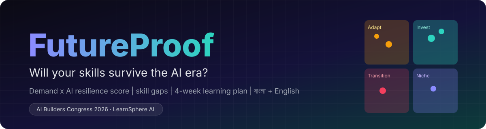
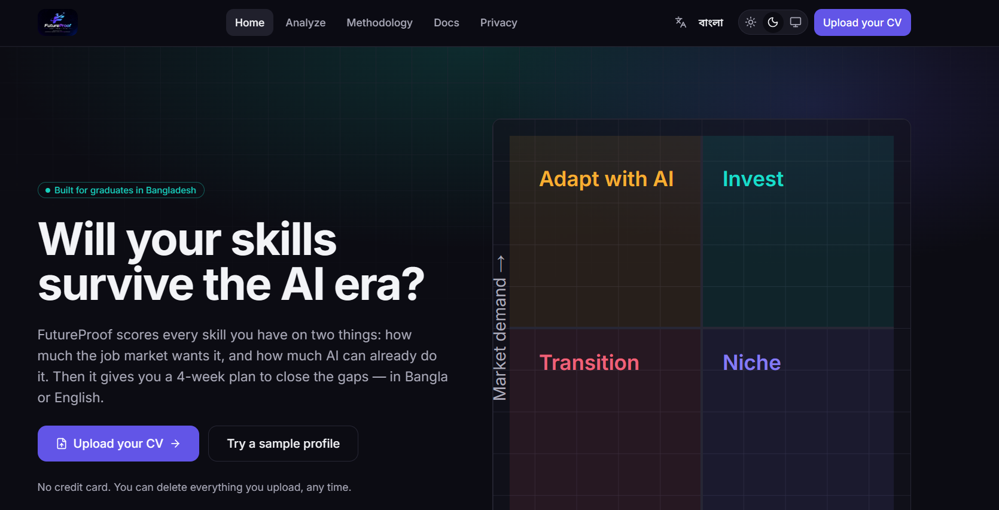
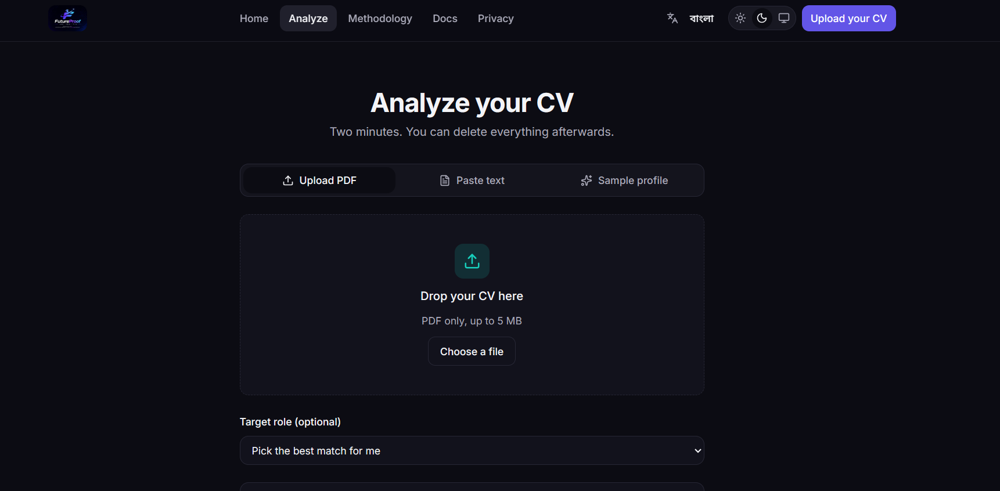
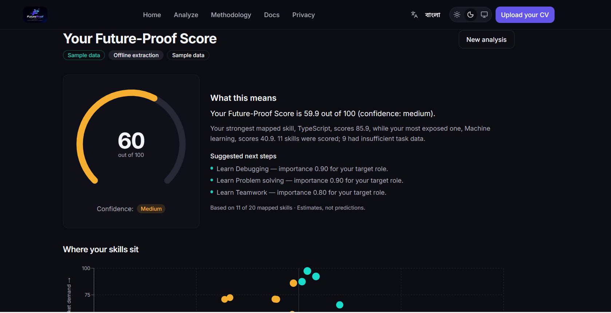
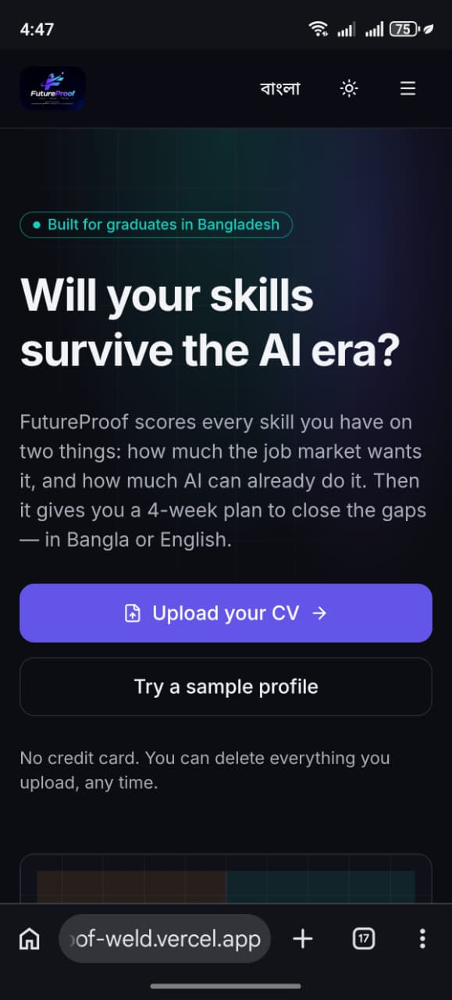
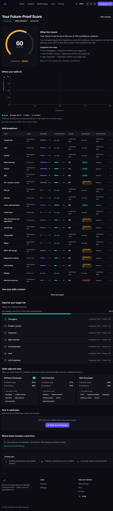
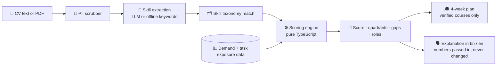

<div align="center">



<br />

**Know where your skills stand in the AI era, and get a 4-week plan to close the gaps.**
<br />
Built for students and fresh graduates in Bangladesh · বাংলা + English

<br />

[](https://nextjs.org)
[](https://www.typescriptlang.org)
[](https://tailwindcss.com)
[](#-testing)
[](LICENSE)

[**Live demo**](#-live-demo) · [**Screenshots**](#-screenshots) · [**Quick start**](#-quick-start) · [**How scoring works**](#-how-the-score-works) · [**Roadmap**](docs/ROADMAP.md)

</div>

---

## 💡 Why FutureProof

Every graduate hears "AI will take jobs". Almost nobody can say **which of their own skills** are at risk, and what to learn next. FutureProof answers three questions in under a minute:

| ❓ Question | ✅ Answer you get |
| --- | --- |
| *How safe are my skills?* | A **Future-Proof Score (0–100)** with a per-skill breakdown |
| *Where should I invest?* | A **quadrant chart**: Invest · Adapt · Niche · Transition |
| *What do I learn next?* | **Skill gaps** for your target role, **safer adjacent roles** and a **4-week plan** |

## ✨ Features

- 🧮 **Two-axis scoring**: market demand × AI resilience, for every skill
- 🔍 **"Why this score?"**: every number shows its source; AI estimates are labelled
- 🇧🇩 **Bangla-first UI**: full `bn` / `en` support, with Bangla CV input
- 📄 **CV upload or paste**: PDF text extraction with automatic **PII scrubbing**
- 🧭 **Gaps and safer roles**: ranked by importance, demand and resilience
- 🎓 **4-week learning plan**: built only from **verified** course links
- 🕸️ **Skill graph** and 📤 **data export / delete** controls
- 🔌 **MCP server**: lets AI assistants query the scoring engine
- 🛡️ **Works offline**: no API keys needed for the full demo

## 📸 Screenshots

<div align="center">

| Landing | Analyze |
| :---: | :---: |
|  |  |

| Future-Proof Score | Mobile |
| :---: | :---: |
|  |  |

<details>
<summary><b>See the full results page</b></summary>
<br />

</details>

</div>

> Screenshots show the built-in **sample profile** and **curated sample data**, not live market statistics.

## 🚀 Live demo

Add your deployed link here: `https://your-app.vercel.app` (after deploying, see [Deployment](#-deployment)).

## ⚡ Quick start

**Requirements:** Node.js **20.9+**

```bash
git clone https://github.com/<your-username>/futureproof.git
cd futureproof
npm install
cp .env.example .env.local      # Windows PowerShell: Copy-Item .env.example .env.local
npm run dev
```

Open **<http://localhost:3000/bn>** (Bangla) or **<http://localhost:3000/en>**. The default is **offline demo mode**: no keys, no external calls.

<details>
<summary><b>🔑 Enable AI extraction (optional)</b></summary>

```env
FUTUREPROOF_OFFLINE=false
LLM_PROVIDER=auto
GROQ_API_KEY=your_key_here
```

Restart, then open `/api/health` and check that `features.llm` is `true`. Supported providers: Groq, Gemini, Anthropic, OpenAI. Blank values are treated as "not set". **Never commit `.env.local`.**

</details>

<details>
<summary><b>🪟 Windows: SWC native binding error?</b></summary>

If `npm run dev` fails with `Failed to load native binding` / `ERR_SWC_NATIVE_CACHE`, delete the SWC cache and retry:

```powershell
Remove-Item -Recurse -Force "$env:LOCALAPPDATA\swc" -ErrorAction SilentlyContinue
npm run dev
```

</details>

## 🧮 How the score works



| Axis | Meaning |
| --- | --- |
| 📈 **Demand** | How much the job market asks for the skill |
| 🛡️ **AI resilience** | `1 − exposure`: how little of the skill's underlying tasks AI can already do |

Each skill lands in a quadrant:

|  | **Low demand** | **High demand** |
| --- | --- | --- |
| **High resilience** | 🟣 **Niche**: safe, small market | 🟢 **Invest**: grow these |
| **Low resilience** | 🔴 **Transition**: plan a move | 🟠 **Adapt**: learn to work with AI |

## 🛡️ Design principles

| Principle | How it is enforced |
| --- | --- |
| 🔢 **The AI never computes a number** | Scores come from tested TypeScript; the LLM only extracts and explains |
| 🧾 **Every number has a source** | Open any skill to see data origin; estimates are tagged |
| 🏷️ **No fabricated data** | Sample data is labelled everywhere; only verified courses are shown |
| 🔒 **Privacy by default** | PII removed before any AI call; export and delete endpoints |
| ⚖️ **Fairness is tested** | Changing name, gender, address or university must not change the score |

## 🧱 Tech stack

| Layer | Technology |
| --- | --- |
| **App** | Next.js 15 (App Router) · TypeScript (strict) · Tailwind CSS · Radix UI · Recharts · Framer Motion |
| **i18n** | next-intl (`bn` default, `en`) |
| **AI** | Vercel AI SDK · zod structured output · Groq / Gemini / Anthropic / OpenAI |
| **Data** | Curated seed JSON by default · optional Supabase (Postgres, pgvector, RLS) |
| **Pipeline** | Python 3.11 ETL (`data-pipeline/`) |
| **Quality** | Vitest · ESLint · Prettier |

## 📁 Project structure

```text
futureproof/
├── app/[locale]/     Pages: landing, analyze, results, methodology, privacy, settings, docs
├── app/api/          analyze · cv/ingest · analysis · graph · me/export · health
├── components/       UI components
├── lib/              Scoring engine, AI wrappers, PII scrubber, data providers
├── messages/         English and Bangla strings
├── data/seed/        Curated sample data (skills, occupations, tasks, courses)
├── data-pipeline/    Python ETL for building and loading the seed
├── supabase/         SQL migrations (optional database)
├── mcp-server/       MCP server exposing the scoring tools
├── tests/            Fairness, extraction, aggregation, i18n tests
└── docs/             Architecture, data sources, security, roadmap
```

## 🧪 Testing

```bash
npm run typecheck   # TypeScript
npm run lint        # ESLint
npm test            # 70 unit tests (Vitest)
```

## 🚢 Deployment

Deploys to **Vercel** with no database:

1. Import the repo at [vercel.com/new](https://vercel.com/new)
2. Set `NEXT_PUBLIC_SITE_URL` (and optionally `GROQ_API_KEY`, `FUTUREPROOF_OFFLINE=false`)
3. Deploy, then check `/api/health`

> Leave Supabase variables unset unless you have run the migrations and loaded the seed.

## ⚠️ Data and limitations

- Skills, tasks, demand figures and courses in `data/seed/` are **curated sample data**, not live market statistics.
- AI exposure values come from a published dataset or a documented rubric ([`docs/EXPOSURE_RUBRIC.md`](docs/EXPOSURE_RUBRIC.md)); estimates are marked.
- Scores show **relative task exposure to AI**. They are **estimates, not predictions** about any person's job.
- Accounts and long-term history are on the [roadmap](docs/ROADMAP.md). Results are kept per session.

## 📚 Documentation

| 📄 Doc | What is inside |
| --- | --- |
| [Architecture](docs/ARCHITECTURE.md) | System diagram and layer rules |
| [Data sources](docs/DATA_SOURCES.md) | Every dataset, licence and limitation |
| [Exposure rubric](docs/EXPOSURE_RUBRIC.md) | How AI exposure is estimated |
| [Data sovereignty](docs/DATA_SOVEREIGNTY.md) | Region, retention, ownership |
| [Security checklist](docs/SECURITY_CHECKLIST.md) | Controls and their status |
| [Roadmap](docs/ROADMAP.md) | What is next, and what is out of scope |

## 🤝 Contributing

Issues and pull requests are welcome. Please run `npm run typecheck && npm run lint && npm test` before opening a PR.

## 📜 License

Released under the [MIT License](LICENSE) © 2026 Rafiul Islam.

<div align="center">

<sub>Built with ❤️ in Bangladesh · <b>FutureProof</b> · International AI Builders Congress 2026</sub>

</div>
