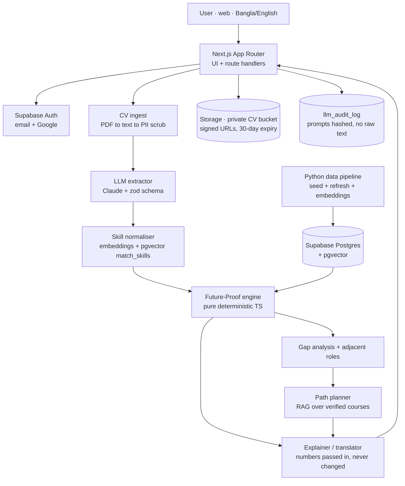

# Architecture

FutureProof scores a person's skills on **market demand** and **AI exposure**, then
generates a 4-week learning plan from a curated course table.

## Layers

| Layer | Location | Notes |
| --- | --- | --- |
| UI | `app/[locale]/**` | App Router, locale segment `bn` / `en` |
| Components | `components/**` | shadcn-style primitives on Radix |
| Domain logic | `lib/scoring/**` (Phase 3) | Pure functions, unit tested, no I/O |
| AI wrappers | `lib/ai/**` (Phase 2+) | `extract`, `embed`, `explain`, `plan` |
| Data access | `lib/supabase/**` | Browser (RLS), server (RLS), admin (service role) |
| Schema | `supabase/migrations/**` | Append-only migrations |
| Data ingest | `data-pipeline/**` | Python, one script per source |

## Knowledge graph (GraphRAG-lite)

Nodes: `skills`, `occupations`, `tasks`, `courses`.
Edges: `occupation_skills`, `task_skills`, `posting_skills`, `courses.skill_ids`.

It lives in Postgres with pgvector for semantic search. That keeps one source of
truth, one backup and one RLS model. When the graph outgrows relational
traversal (multi-hop role transitions), the join tables migrate to a graph
database without changing the application contract.

## Determinism rule

The LLM may **extract**, **explain** and **translate**.
It may never produce or alter a number. Every score comes from tested code in
`lib/scoring`, and every displayed number carries a source or method label.
